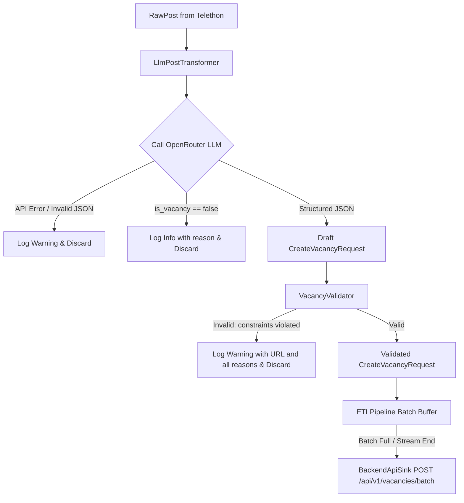

# Telegram Vacancy Parser: LLM-Based Extraction & Domain Validation Design

**Date:** 2026-10-31  
**Status:** Approved  
**Scope:** `apps/parsers/telegram`, `contracts/openapi`

## 1. Context & Motivation

Previously, the Telegram parser relied on regex-based heuristic guessing (`HeuristicExtractor`) to extract job fields (title, company, salary text) from raw post text. This approach had multiple shortcomings:
- Low extraction accuracy on varied formats, slang, and multilingual posts.
- Inability to discern whether a post is truly a job vacancy or channel advertisement/announcement.
- Outdated vacancy contract: the backend was updated to a rich domain model (`apps/backend/internal/domain/model/vacancy.go` and `dto/entities.go`) with structured salary bounds, currency requirements, employment types, grades, location decomposition, and strict string length constraints (e.g. description 300..2500 characters).
- Lack of detailed logging when vacancies are filtered or fail validation.

## 2. Architecture & Design Decisions

### 2.1 Sharing Business Rules Across Microservices
In this polyglot setup (Go backend + Python ETL parsers), we adhere to **Contract-First with Client-Side Domain Rules Enforcement**:
1. **OpenAPI Specification (`contracts/openapi/`)**: Serves as the single source of truth for schemas, types, and baseline constraints (`minLength`, `maxLength`, `enum`, ranges).
2. **Dedicated Validation Layer (`src/validation/`) in Parser**: A Pydantic v2-based domain validator mirroring Go domain invariants (`apps/backend/internal/domain/model/vacancy.go`). It acts as a deterministic gatekeeper, preventing non-compliant payloads from reaching the backend and eliminating unnecessary network load.
3. **Structured Rejection Logging**: Any post rejected by the LLM or failing validation produces an explicit log message detailing the vacancy URL and specific failure reasons.

### 2.2 LLM Extraction via OpenRouter
- The transformer uses OpenRouter (`https://openrouter.ai/api/v1`) via an asynchronous HTTP client (`httpx.AsyncClient`).
- Configurable via environment variables: `LLM_BASE_URL`, `LLM_API_KEY`, `LLM_MODEL`, `LLM_TIMEOUT`.
- The system prompt enforces strict JSON output without hallucination:
  - If a post is not a job vacancy or lacks essential role/duty details: outputs `{"is_vacancy": false, "reason": "..."}`.
  - If it is a vacancy: extracts structured attributes matching the backend domain model.

### 2.3 Strict Domain Invariants
- `title`: 3..100 characters.
- `company`: 2..100 characters (optional).
- `salary`: optional; `text` (2..150 chars); `from`/`to` (0..100,000,000, `from <= to`). Bounds require 3-letter currency code; currency requires at least one bound.
- `grade`: `intern`, `junior`, `middle`, `senior`, `lead`.
- `employment_types`: non-empty subset of `remote`, `office`, `hybrid`, `contract`.
- `location`: optional; `text` (2..80 chars), `country` (2..40 chars), `city` (2..50 chars). `city` requires `country`.
- `description`: 300..2500 characters. Posts with descriptions < 300 characters are strictly rejected as low-quality.
- `url`: 10..1024 characters.
- `published_at` / `parsed_at`: valid within 7 days in past, max 5 min future skew; `parsed_at >= published_at`.

## 3. Data Flow

## 4. Components & File Modifications

1. `contracts/openapi/spec-files/models.yaml`:
   - Update `CreateVacancyRequest` schema to include structured `Salary`, `Location`, `grade`, `employmentTypes`, and validation constraints.
2. `apps/parsers/telegram/src/config.py`:
   - Add settings for `llm_base_url`, `llm_api_key`, `llm_model`, `llm_timeout`.
3. `apps/parsers/telegram/src/models/vacancy.py`:
   - Update Pydantic DTO models: `SalaryDTO`, `LocationDTO`, `CreateVacancyRequest`, `BatchCreateVacanciesRequest`, `BatchCreateVacanciesResponse`.
4. `apps/parsers/telegram/src/validation/rules.py` & `validator.py`:
   - Implement business constants and `VacancyValidator` with detailed reasons.
5. `apps/parsers/telegram/src/transformer/llm_extractor.py`:
   - Implement OpenRouter client and prompt orchestration replacing `heuristics.py`.
6. `apps/parsers/telegram/src/transformer/post_parser.py`:
   - Connect LLM extractor and validator.
7. `apps/parsers/telegram/tests/`:
   - Update unit tests with table-driven tests for validator and mock tests for LLM extraction.
